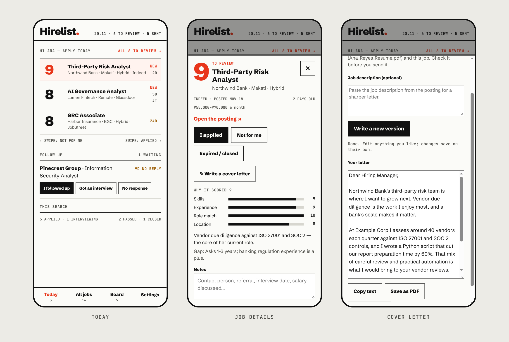
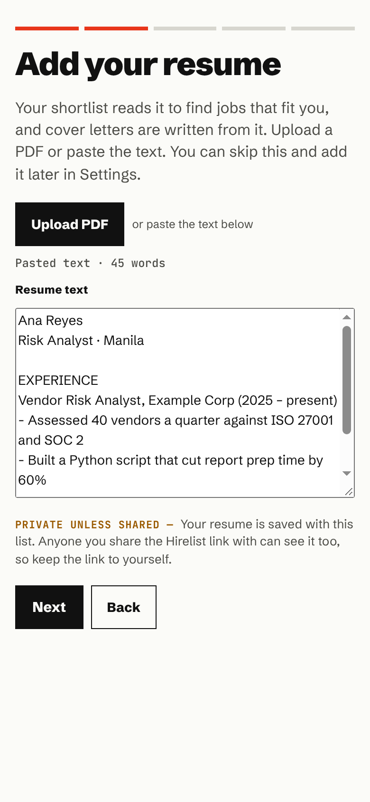
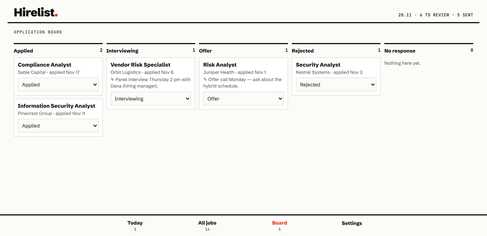
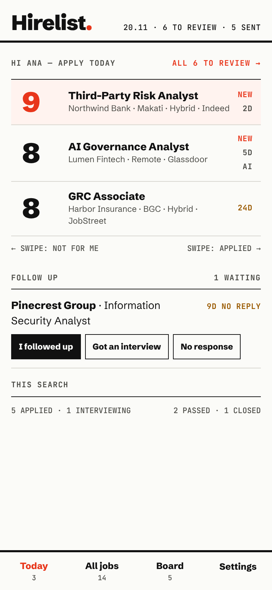
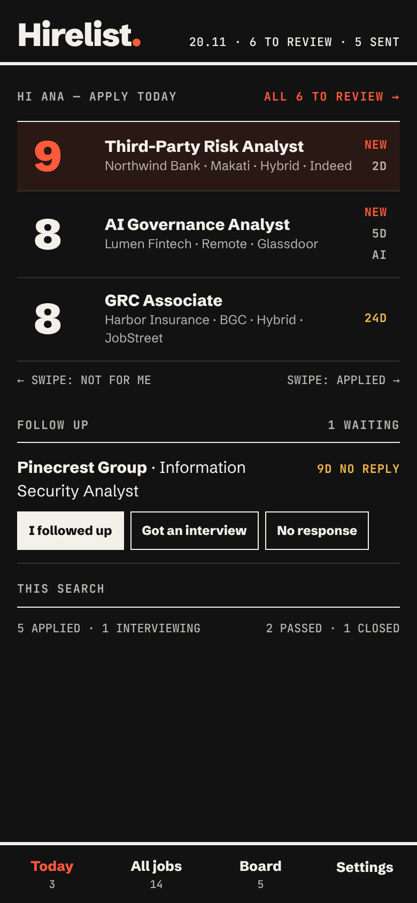

<h1 align="center">Hirelist.</h1>

<p align="center">
  <a href="https://github.com/louiscada/hirelist-skill/actions/workflows/tests.yml"></a>
  <a href="https://github.com/louiscada/hirelist-skill/releases/latest"></a>
  <a href="LICENSE"></a>
</p>

A free Claude skill that job hunts for you every weekday. It reads your resume, searches job sites for roles that fit, skips anything you've already seen, and sends you a short ranked list. Your own tracker page keeps every job, lets you swipe each one into Applied or Not for me, follows your applications to an offer, and writes a cover letter for any job in one tap.

You still click Apply yourself. Hirelist never applies, signs in or messages employers for you.

<p align="center"></p>
<p align="center"><sub>The jobs, companies and person in these images are made up.</sub></p>

## Features

**Finds jobs that fit you**

- Searches several job sites every weekday, not just one, and opens every posting it lists to check it's live
- Matches against your saved resume and your roles in priority order
- Skips roles asking for more years than you set, senior titles, and anything on your avoid list
- Every job gets a fit score out of 10, a line on why it fits, a line on any gap, and a breakdown into skills, experience, role and location
- Tested daily for the Philippines, with starting points for Singapore, Malaysia, India, Australia, the UK, the US and company hiring boards everywhere

**Never shows you the same job twice**

- Everything it finds goes into your tracker, and the next run skips anything already there
- Jobs you've applied to, passed on or marked closed never come back

**Makes sorting quick**

- **Today** shows the three best jobs to apply to and the applications waiting on a follow-up
- Swipe right for applied, left for not for me. On a computer, use the buttons or keys: J and K to move, A, X and E to sort, U to undo
- Every action can be undone
- **All jobs** has search and filters: best fit, newest, AI roles, remote, by job site, by status
- **Board** follows each application through Applied, Interviewing, Offer, Rejected and No response
- Notes on every job for contacts, interview dates and salary talks

**Writes cover letters**

- Open any job and tap **Write a cover letter**. Claude writes 170–230 words from your resume, using only facts that are in it
- Paste the job description for a sharper letter
- Edit it in place, then copy it, save it as a PDF, or save it as a Word file

**Optional extras, each with a switch**

- **Learn from "Not for me":** pick a quick reason when you pass on a job, and the next runs adjust
- **Flag closed postings:** each run checks your unreviewed jobs and marks closed ones as Expired
- **Follow-up reminders:** after a number of days you choose

## A closer look

### Setting up

A five-step intro on first open: welcome, your resume (upload a PDF or paste it), your search, your extras, done.

<p align="center"></p>

### The board

<p align="center"></p>

### Light and dark

It follows your phone or computer's setting.

<p align="center">&nbsp;&nbsp;&nbsp;</p>

## Quick start

**1. Download `hirelist.zip`** from the [latest release](https://github.com/louiscada/hirelist-skill/releases/latest), under **Assets**. Don't unzip it.

**2. Install it in the Claude app:**

1. Turn on **Code execution and file creation** in **Settings → Capabilities**.
2. Go to **Customize → Skills**, click **+**, choose **Create skill → Upload a skill**, and pick `hirelist.zip`.
3. On a Team or Enterprise plan, your admin may need to allow skills first.

**3. Say:**

> Set up Hirelist.

Claude publishes your tracker. You go through the short intro: resume, roles, extras. Then Claude sets up the weekday search and offers to run the first one right away.

**Claude Code:** clone the repository and copy the `hirelist` folder into your skills folder:

```bash
git clone https://github.com/louiscada/hirelist-skill.git
cp -r hirelist-skill/hirelist ~/.claude/skills/
```

**Sharing Hirelist with a friend?** Send them `hirelist.zip`. They need steps 2 and 3, nothing else.

**Updating:** upload a newer `hirelist.zip` the same way, then say "update my Hirelist page". Your saved jobs and settings stay.

## What you need

| | |
| --- | --- |
| Claude app | Hirelist is built for it: the tracker is a Claude artifact with its own database, and the daily search is a Claude scheduled task |
| Scheduled tasks | Needed for the automatic weekday run. Check that your plan has them. Without them, say "run my shortlist" each morning |
| Cover letters | Use Claude, so they count toward your normal Claude usage. The page asks your permission the first time |

**Other AI apps that read skills** can run the search part with a plain `jobs.csv` file in your folder instead of the tracker page. See [`hirelist/reference/without-tracker.md`](hirelist/reference/without-tracker.md). This mode is newer and less tested.

## Using it

### The daily message

Each weekday you get a ranked list: title, company, location, posting date, job site, years asked, salary (only if posted), fit score, why it fits, any gap, and the link. AI roles are marked [AI]. After the list it adds a few lines when they apply:

- applications due a follow-up
- what it adjusted from your feedback
- how many closed postings it flagged
- which resume it matched against
- any job site that failed that day

### Settings

| Setting | Default |
| --- | --- |
| Your resume | Upload a PDF or paste the text. Replace it any time |
| Roles you want, most important first | Read from your resume until you set them |
| Most years a job may ask for | 3 |
| Roles or companies to avoid | None |
| Location | Remote for your country, or near you |
| Minimum salary | None. Only applied when a posting lists pay |
| Learn from "Not for me" | On |
| Flag closed postings | On |
| Follow-up reminders | On, after 7 days |

## Privacy

- Your resume, settings and jobs are stored in your tracker's own database, which belongs to your Claude account. **Anyone you share the tracker link with can see them**, so keep the link to yourself.
- This project runs no server and collects nothing.
- Searching and cover letters are done by Claude, under Anthropic's privacy terms.
- The tracker page loads three libraries from cdnjs: PDF.js reads resume PDFs, and jsPDF and JSZip build the letter files. It also loads its fonts from Google Fonts. Your resume never leaves the page for these: PDFs are read and files are built inside your browser.
- The `.gitignore` excludes `hirelist-data/`, `jobs.csv` and resume PDFs, so forking this repository won't publish your job search.

## Limits worth knowing

- **LinkedIn can't be read by an automated search.** It blocks automated access, and Hirelist doesn't try to get around that. Most LinkedIn postings also appear on company careers pages, which Hirelist does search. For the rest, turn on LinkedIn's own job alerts.
- **Job sites change.** A board can block or change its pages. Each run names any site that failed so you're not left guessing.
- **Fit scores are judgment, not a formula.** Claude scores each job against your resume. Treat them as a sorting aid, not a verdict.
- **Cover letters need checking.** They're written only from your resume, but read each one before you send it.
- **Resume PDFs** that are scanned images have no text to read. Paste the text instead.

## Developing

The skill is plain files: instructions in Markdown and one self-contained tracker page. There's no build step, apart from zipping the folder for releases.

| File | Role |
| --- | --- |
| `hirelist/SKILL.md` | What Claude reads first: the flows and the rules |
| `hirelist/assets/hirelist.html` | The tracker page, published as each user's artifact |
| `hirelist/reference/setup.md` | First-time setup and the database fields |
| `hirelist/reference/daily-run.md` | The scheduled task's prompt, with placeholders |
| `hirelist/reference/job-sites.md` | Job sources by country |
| `hirelist/reference/without-tracker.md` | The `jobs.csv` fallback |
| `hirelist/templates/jobs.csv` | Empty fallback file |
| `tools/build_skill.py` | Builds `dist/hirelist.zip` and `dist/hirelist.skill` |
| `tests/test_package.py` | Checks that the skill and the tracker page agree |

Run the tests from the repository root (Python 3.9+; the JavaScript checks also need Node.js):

```bash
python -m unittest discover -s tests -v
python tools/build_skill.py
```

Every push runs them on GitHub; the Tests badge at the top shows the result. Issues and pull requests are welcome. See [CONTRIBUTING.md](CONTRIBUTING.md) and the [changelog](CHANGELOG.md).

### Releasing a new version

1. Change `VERSION` in `hirelist/assets/hirelist.html`, and add the notes under that version in `CHANGELOG.md`.
2. Commit and push.
3. On GitHub, open Releases, choose "Draft a new release", and set the tag to the same version with a `v` in front, for example `v1.0.1`. Publish it.

The release workflow runs the tests and attaches `hirelist.zip` and `hirelist.skill` to the release.

## Author

Developed by Louis Cada ([GitHub](https://github.com/louiscada), [LinkedIn](https://www.linkedin.com/in/louis-cada-3943062a2/)). For questions, bugs or ideas, [open an issue](https://github.com/louiscada/hirelist-skill/issues/new/choose). The same link is at the bottom of Settings in every tracker.

## License

Hirelist is free to use under the [Apache License 2.0](LICENSE). You can use it, adapt it for yourself and share it, as long as you keep the copyright and license notices (see [`NOTICE`](NOTICE)).

The license does not grant rights to the Hirelist name. If you publish a modified version, please give it a different name so people can tell it apart from the official Hirelist.
